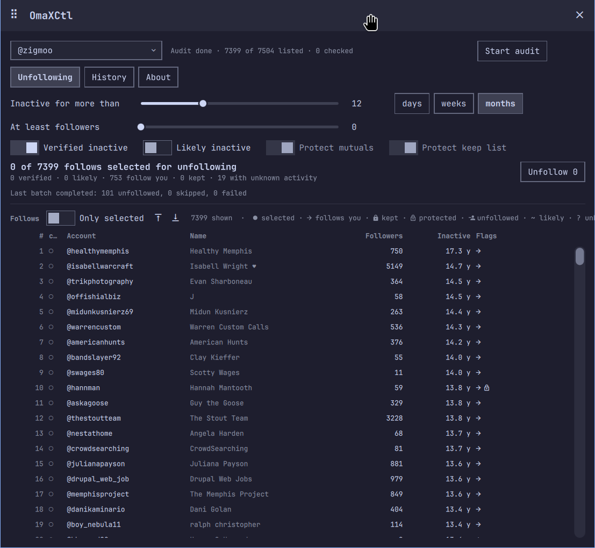

# OmaXCtl

OmaXCtl (`moo.omaxctl`) is an Omarchy shell plugin for auditing the accounts you follow on X and pruning inactive ones. It is the control surface; `x_tool following` in the DIL toolbox is the engine. The plugin runs `x_tool` commands and never clicks X itself.

Not to be confused with the marketplace plugin omaX (`MoizIbnYousaf/omaX`), a keyboard-first X client.

## Install

```bash
omarchy plugin add https://github.com/zigmoo/omaxctl.git --enable
```

## Remove

```bash
omarchy plugin remove moo.omaxctl
```



## Planned panel

- Account selector at the top.
- Filter form: inactive window (days, weeks or months), minimum followers, Verified inactive and Likely inactive choices. Mutuals and the keep list are always protected.
- Count of accounts the filters select, and an Unfollow button that becomes a countdown with Cancel while a batch runs.
- Ultra-compact rows you can inspect, filled live while the follows audit is still running.
- History tab listing the backup taken before each batch, with each account's result.

## Engine commands

`x_tool following accounts`, `observations`, `audit-run`, `audit-status`, `audit-cancel`, `prune-run`, `prune-status`, `prune-cancel`, `backups`, `backup-show`. See `x_tool/README.relationships.md` in the DIL toolbox.

## Local development

To work from the DIL source checkout, link the whole folder into Omarchy's plugin directory.

```bash
ln -s ~/dil/plugins/omaxctl ~/.config/omarchy/plugins/moo.omaxctl
omarchy plugin validate ~/dil/plugins/omaxctl
omarchy plugin enable moo.omaxctl
```

Task: DIL-3473. License: Apache-2.0.
